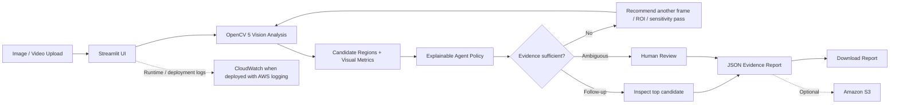

# VisionGuard AI — Autonomous Visual Inspection Agent

**Competition concept:** OpenCV 5 + AWS, with a focus on Agentic Vision.

VisionGuard AI is a single-file Streamlit prototype for exploring visual inspection workflows. It accepts an inspection image or video, runs substantive OpenCV analysis, ranks candidate regions, selects a follow-up action from the visual results, and exports an evidence-backed JSON report. An optional Amazon S3 integration stores the report and annotated frame.

> **Important limitation:** The current implementation uses explainable classical computer-vision heuristics. It does **not** provide a trained or validated industrial defect classifier, and candidate scores are not calibrated defect probabilities. It is a prototype and must not be used to certify equipment safety.

## Features

- Single-file application: `app.py`
- Image inspection and sampled video inspection
- OpenCV grayscale conversion, Gaussian denoising, Canny edge detection, morphological closing, contour extraction, candidate ranking, and annotated output
- Deterministic, explainable agent policy: visual results change the recommended next inspection step
- Frame-by-frame video summary
- JSON report export with input SHA-256, runtime versions, candidates, agent trace, and limitations
- Optional S3 upload using the standard AWS credential chain or an EC2 IAM role
- Dark dashboard with inspection metrics and visual evidence

## Architecture



### AWS component

The app's optional S3 upload is a real AWS integration when configured. Run the app on AWS EC2 for a meaningful cloud-hosted component. CloudWatch can collect application and instance logs when configured in the deployment. The app does not automatically create AWS infrastructure.

**Do not claim an AWS deployment until you have actually deployed and tested it.** For the COOL award path, this project still needs a reproducible benchmark showing COOL executing the core workload on AWS Graviton; the current code does not implement COOL.

## Requirements

- Python 3.11 recommended
- A verified OpenCV 5 Python wheel/build compatible with your environment
- Streamlit
- NumPy
- Pillow
- Optional: boto3 and AWS credentials for S3 upload

The competition requires OpenCV 5. The exact availability and package version of OpenCV 5 wheels may vary by platform. The app displays the installed OpenCV version and warns if the major version is not `5`. Do not silently substitute OpenCV 4 for a final competition submission.

## Setup

### 1. Create and activate a virtual environment

Windows PowerShell:

```powershell
py -3.11 -m venv .venv
.\.venv\Scripts\Activate.ps1
python -m pip install --upgrade pip
```

macOS/Linux:

```bash
python3.11 -m venv .venv
source .venv/bin/activate
python -m pip install --upgrade pip
```

### 2. Install dependencies

Review `requirements.txt`. Install a verified OpenCV 5 wheel/build for your operating system, then install the remaining packages:

```bash
pip install -r requirements.txt
```

If pip cannot resolve the pinned OpenCV package for your platform, install the official/verified OpenCV 5 Python build supported by the competition, update the pin to the exact version that worked, and record the Python/platform combination. Confirm the runtime:

```bash
python -c "import cv2; print(cv2.__version__); assert cv2.__version__.split('.')[0] == '5'"
```

### 3. Launch

```bash
streamlit run app.py
```

Open the local URL printed by Streamlit, typically `http://localhost:8501`.

## Demo walkthrough

1. Choose **Image inspection** or **Video inspection**.
2. Upload a close-up equipment image or a short MP4 video.
3. Adjust edge sensitivity and minimum candidate area.
4. Review the annotated frame, edge map, grayscale output, and candidate table.
5. Inspect the agent decision trace. The action changes based on the detected candidate count, strongest shape score, and edge density.
6. Download the JSON report.
7. Optionally enter an S3 bucket name in the sidebar and upload the report plus annotated frame.

For a clean demo, use a publicly shareable or synthetic sample image/video that you have permission to use. Explain that the detected boxes are **candidate visual regions**, not confirmed defects.

## Optional AWS S3 setup

Configure AWS credentials outside the app. Recommended options:

- Local development: AWS CLI profile (`aws configure`) or an appropriate SSO profile
- EC2 deployment: attach an IAM instance role with least-privilege `s3:PutObject` permissions for the intended bucket/prefix

Set the bucket name in the sidebar or environment variable:

```powershell
$env:VISIONGUARD_S3_BUCKET="your-bucket-name"
$env:VISIONGUARD_S3_PREFIX="visionguard/"
```

macOS/Linux:

```bash
export VISIONGUARD_S3_BUCKET="your-bucket-name"
export VISIONGUARD_S3_PREFIX="visionguard/"
```

The S3 integration uploads `report.json` and `annotated.jpg`. Use a private bucket, block public access, and avoid uploading sensitive imagery without authorization.

## Testing checklist

- [ ] OpenCV major version is 5 in the final environment.
- [ ] Valid JPEG/PNG input is processed.
- [ ] Invalid image and unsupported/corrupt video inputs show a clear error.
- [ ] Video frame sampling returns timestamps and per-frame metrics.
- [ ] Increasing sensitivity changes the edge/candidate output on a suitable test image.
- [ ] The agent decision changes when the visual analysis outputs change.
- [ ] JSON report downloads and contains the run ID and input SHA-256.
- [ ] S3 upload succeeds with the intended IAM permissions (if enabled).
- [ ] Failure cases are recorded: glare, low light, blur, occlusion, textured surfaces, and no-candidate cases.
- [ ] Metrics are calculated on a labeled test set before making performance claims.

## Evaluation plan

Use a labeled dataset with a fixed train/validation/test split if adding a learned detector. For the current heuristic prototype, evaluate candidate-region coverage and false-positive burden against annotated regions. Compare:

1. Single-pass visual analysis.
2. Analysis plus agent-directed follow-up (additional frame, ROI, or threshold pass).

Report measured precision/recall only if candidate regions can be matched to ground-truth annotations using a defined overlap criterion. Also record end-to-end latency, failure rate, and human escalation rate. Include representative false positives and missed cases.

## Security and responsible use

- Never hard-code AWS keys or commit `.env` files.
- Use least-privilege IAM and private S3 buckets.
- Avoid storing unnecessary raw footage or personal data.
- Keep a human in the loop for maintenance and safety decisions.
- Treat all scores as heuristic indicators, not probabilities.
- Validate on the actual target equipment, lighting, camera geometry, and labeled failure cases before operational use.

## Competition readiness checklist

This is a runnable prototype scaffold, not a claim that every competition requirement is already satisfied.

- [ ] Verify and pin the OpenCV 5 build used by the final deployment.
- [ ] Deploy a working endpoint or prepare a live screen-share demo.
- [ ] Add a real, repeatable labeled-data evaluation and include failure cases.
- [ ] Deploy to AWS and capture the actual architecture/configuration.
- [ ] If claiming Agentic Vision, record a trace proving a vision output changed a later tool call/action.
- [ ] If claiming COOL, run the core workload through COOL on AWS Graviton and benchmark against a suitable baseline.
- [ ] Record a public or unlisted demo video no longer than five minutes.
- [ ] Document actual deployment steps, dependency versions, limitations, and responsible-use measures.

## License

MIT License. Add your name/team and year before publishing; see `LICENSE`.
